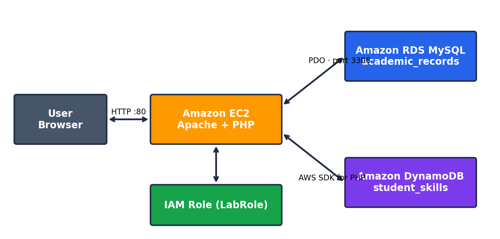
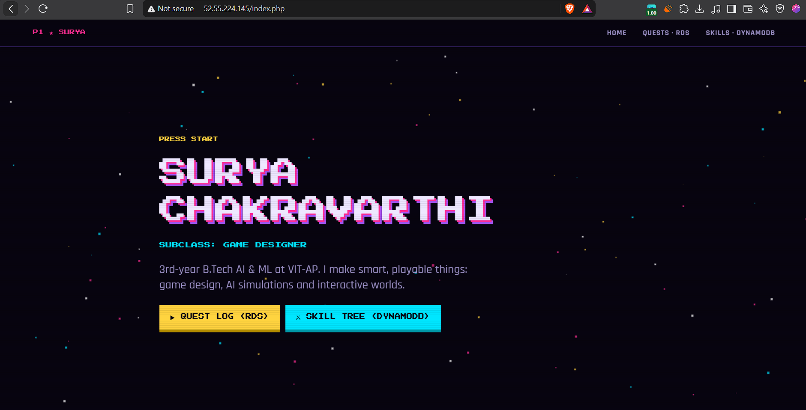
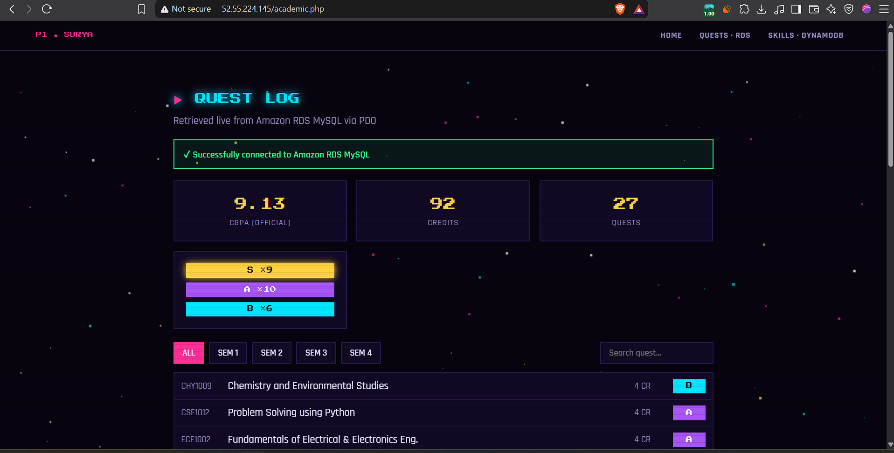
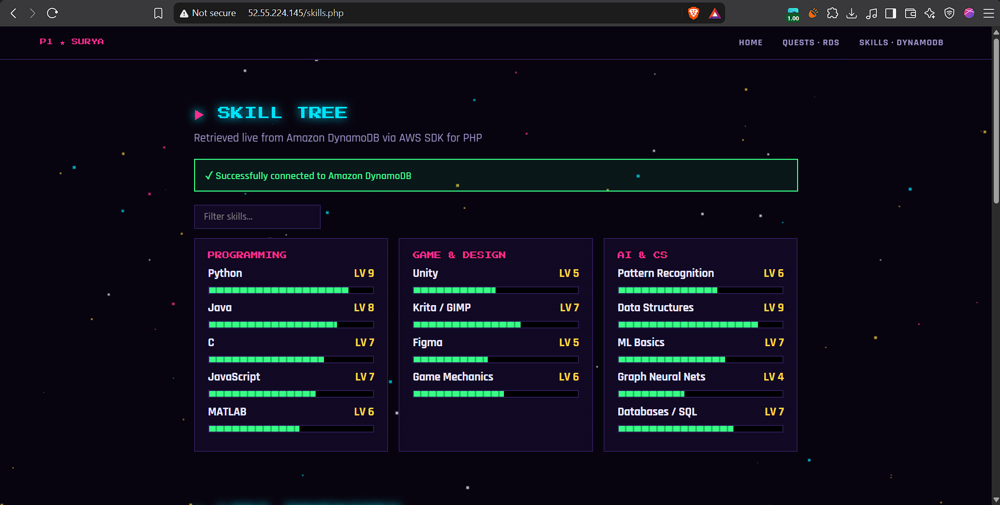
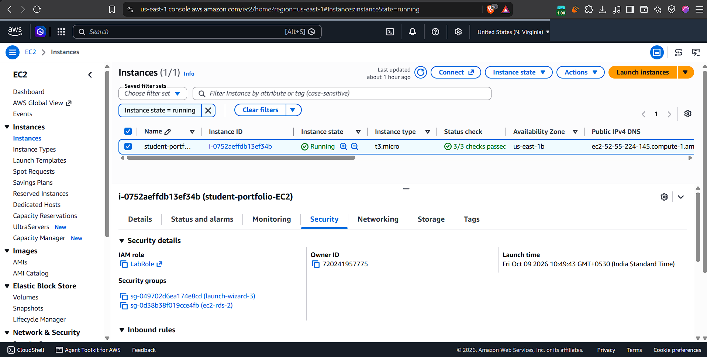
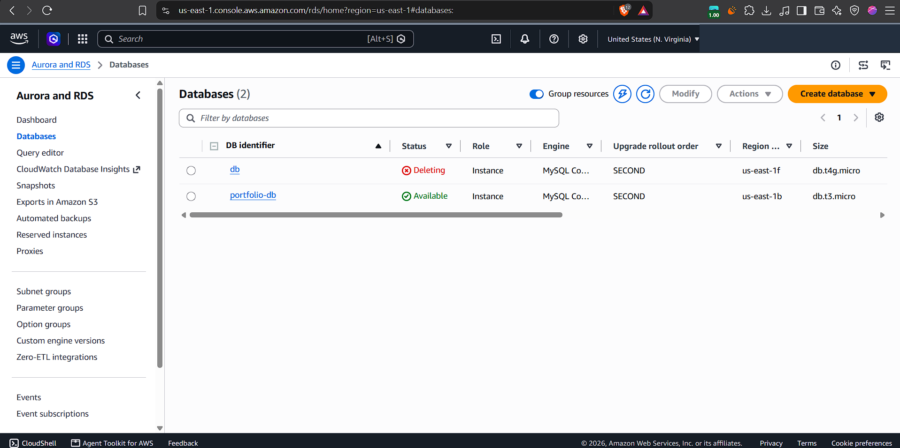
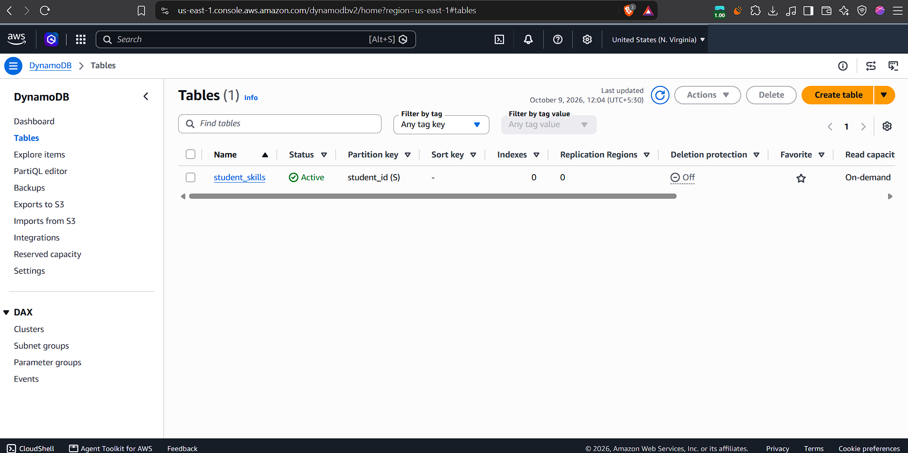

# Dynamic Student Portfolio on AWS (EC2 + RDS MySQL + DynamoDB)

Game-themed PHP portfolio that uses **two AWS databases**, each matched to its data:

| Page | Data | Service | Access |
|---|---|---|---|
| `academic.php` | 27 courses with code, credits, grade, semester | Amazon RDS MySQL | PHP PDO |
| `skills.php` | skills, certifications, projects | Amazon DynamoDB | AWS SDK for PHP + IAM role |

Hosted on Amazon EC2 (Ubuntu 24.04, Apache, PHP 8.3). No AWS keys are stored in the code; MySQL credentials live outside the web root.

## Screenshots
| | |
|---|---|
|  |  |
|  |  |
|  |  |

More: [EC2 inbound rules](docs/screenshots/07-ec2-inbound-rules.png) · [S3 static hosting](docs/screenshots/08-s3-static-hosting.png)

## Report
[Assignment 3 report (PDF)](docs/Assignment3_Report_Surya_Chakravarthi.pdf)

## Run it yourself
See [docs/DEPLOY.md](docs/DEPLOY.md). Copy `private/db_config.example.php` to `/var/www/private/db_config.php` and add your own credentials. **Never commit the real file.**

## Note
The live EC2 demo runs inside a temporary AWS Learner Lab and is only online during lab sessions, so the screenshots and report above serve as proof of the working deployment.

Author: Malaganti Pardha Surya Chakravarthi · VIT-AP University
